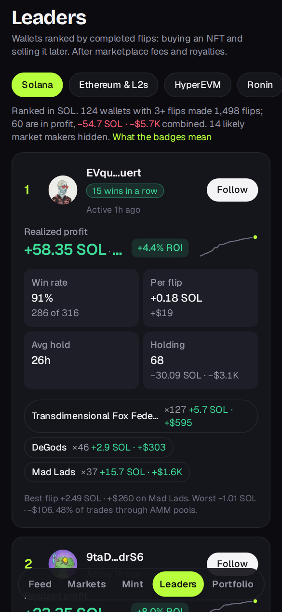
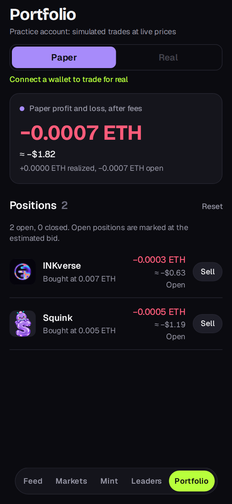
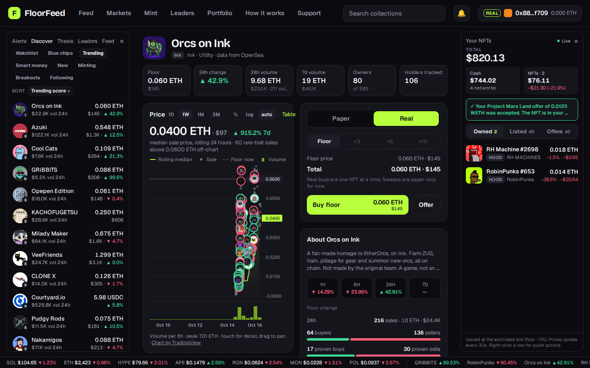
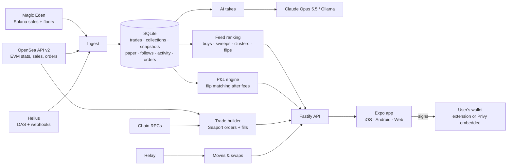

<div align="center">

# FloorFeed

**Follow the NFT traders who actually win, and trade alongside them.**

A live feed of what wallets with a real track record are buying, across Solana, Ethereum and ten more chains, with an AI read on each trade. Practice on paper, or buy, sell, list and make offers for real from your own wallet.

### [▶ Live: floorfeed.io](https://floorfeed.io)
<sub>Live mainnet data. One codebase: phone layout on mobile, multi-panel layout on desktop.</sub>


<table>
  <tr>
    <td align="center"><br/><sub><b>Feed</b>: proven wallets' buys, Buy floor or Offer</sub></td>
    <td align="center"><br/><sub><b>Leaders</b>: P&amp;L after fees, ROI, win rate</sub></td>
    <td align="center"><br/><sub><b>Wallet</b>: track record and activity</sub></td>
    <td align="center"><br/><sub><b>Portfolio</b>: paper or real, in dollars</sub></td>
  </tr>
  <tr>
    <td align="center"><br/><sub><b>Markets</b>: ~170 collections, 12 chains</sub></td>
    <td align="center"><br/><sub><b>Collection</b>: Trade box, price chart, depth</sub></td>
    <td colspan="2"></td>
  </tr>
</table>

<br/>
<sub><b>Desktop</b>: Discover panel (sortable lists), the feed, and Your NFTs with your total, cash and NFTs always in view</sub>

 

<sub>Left: a collection offer, ready to sign (steps 1–2 done). Right: a collection page. Screenshots show live mainnet data from October 2026.</sub>

</div>

---

## Why this exists

Social trading apps like FOMO made memecoin trading feel like a social feed: you see what good traders buy, follow them, and copy a trade with one tap. They work because **every trade is public on-chain**, so a trader's track record can be checked.

NFT trading has the same public data, but no product like this existed for it. FloorFeed is that product, built as a portfolio project across three areas:

| | What it shows |
|---|---|
| 📱 **Mobile + web** | Expo Router with native tabs, one codebase for iOS, Android and a responsive web app (phone layout, desktop with side panels), PWA install, push alerts, haptics, right-click / long-press quick menus |
| 🧠 **AI** | A one-line take on notable trades from **Claude**, with server-side refusal fallback and per-trade caching, falling back to a local Ollama model so the demo costs nothing to run |
| ⛓️ **Crypto** | Ingest and P&L for ~170 collections on 12 chains; **real trading through OpenSea's Seaport** (buy, sell into the best offer, list, item and collection offers, free cancels), every transaction simulated before your wallet sees it; cross-chain moves and swaps via Relay; card deposits; and an NFT launchpad with its own contracts |

## What you can do

| | |
|---|---|
| **Feed** | **Buys** (buys, sweeps, clusters; Top or Latest), **Flips** (all or profitable, after fees) and **Thesis** tabs. Filters for Everyone / Following, chain, and **Hide bots** (market-making wallets). Every buy card ends in **Buy floor** and **Offer** |
| **Discover & Markets** | Watchlist, Blue chips, Trending, Smart money, **New** (newest first, including projects that just minted out), Minting, Breakouts, Following, each sortable by volume, sales, floor change, floor, age or holders. Dollar values next to every coin amount |
| **Collections & NFTs** | Rolling-median price chart with volume, floor depth, holders, sales, flippers, rarity ranks and trait shares, theses from holders |
| **Leaders & wallets** | Flip P&L after fees, ROI, win rate, hold time, streaks, per-collection results, market-maker detection |
| **Paper trading** | Buy the floor (or sweep ×3 / ×5 / ×10) at live prices with no wallet; positions marked at the estimated bid |
| **Real trading** (EVM) | Buy listings, **sell into the best offer** (item, trait or collection), **list** at your price, **make offers** on an NFT or a whole collection, edit and cancel both for free. Multi-step flows (wrap → allow → sign) show as one step tracker |
| **Money** | Balances on every network, **move and swap between networks** (ETH → HYPE, SOL → ETH…) via Relay, card deposits via Privy/MoonPay, wrap and unwrap, send |
| **Portfolio** | Total, cash and NFTs (also pinned in the desktop **Your NFTs** panel with Owned / Listed / Offers tabs), notices when an offer of yours is accepted |
| **History** | Every buy, sale, listing and offer with its outcome (sold / accepted, cancelled, expired), mints, transfers and wallet moves; CSV export |
| **Launchpad** | Create and mint your own PFP collection on Ethereum, Base or Robinhood Chain (contracts in [`contracts/`](contracts/README.md)) |
| **Alerts** | Follow wallets and get their trades in an inbox and as browser push notifications |

## How NFTs change the design

NFTs aren't interchangeable the way tokens are, so a straight copy of FOMO doesn't work:

| | Token app | FloorFeed |
|---|---|---|
| **Copy a trade** | Buy the same token | Buy the **collection floor**, or **offer** under it, because the exact NFT is already sold |
| **Exit** | Sell into the pool's liquidity | **Sell into the best offer** (item, trait or collection: whichever pays most after fees), or list at your price |
| **Unrealized P&L** | Token price × size | Marked at the **estimated bid, not the floor**. The floor is what sellers ask, not what you'd get |
| **Trader score** | P&L on a token | P&L on **flips**: a wallet selling a mint it bought earlier, after marketplace fees and royalties |

## How it works



**Ingest.** Rate-limited clients pull sales and floors: Magic Eden for Solana (tiered so the top 20 get full polling and the rest load on demand), OpenSea for EVM chains (a 30-day sales backfill, then polling). Discovery keeps each chain's busiest collections daily and, every 3 hours, adds projects that just minted out and already trade. A floor of 0 (nothing listed) is stored as "no floor", not a free NFT.

**P&L.** For every sale, SQL finds the seller's earlier buy of the same mint; each pair is a flip, scored after marketplace fees and royalties. Wallet stats, the leaderboard and market-maker detection (wallets trading mostly through pools or accepted bids) come from those pairs.

**Feed.** Trades become buy, sweep (one wallet, 3+ in 15 minutes), cluster (3+ wallets in 6 hours) and flip events. Top ranks the last 72 hours by who traded, how much and how recently, with diversity penalties and at most one cluster in three cards. Cards say how today's floor compares with what buyers paid.

**Trading, safely.** The server builds every transaction and runs it against the chain as the user (`eth_estimateGas`) before the wallet sees it, so a listing that just sold or a short balance is caught without costing gas. Listings and offers are Seaport orders the wallet signs as typed data (no gas), posted to OpenSea on its signed zone so cancels are free signatures. Amounts are converted from decimal strings, never `toFixed(18)`, because float noise changes the amount and OpenSea rejects bids off its 0.0001 grid. All OpenSea calls share one rate limit with two lanes: requests from someone's open trade sheet go ahead of background work.

**Money between networks.** Relay quotes an exact-output transfer (what you type is what arrives), FloorFeed simulates the single deposit, and the sheet follows it until it lands. When the coins differ (ETH → HYPE on HyperEVM) it's a swap and a transfer in one step, which is how HyperEVM, ApeChain, Ronin and Monad NFTs become buyable from ETH.

**AI takes.** Generated on demand the first time a card is shown and cached per trade. The model gets compact JSON (price, floor, volume, the buyer's record) and a prompt that asks for one specific, numeric sentence and forbids buy/sell advice. Claude runs at `low` effort with `fallbacks: "default"`.

## Tech stack

| Layer | Choice |
|---|---|
| App | Expo SDK 57, React Native 0.86, React 19, Expo Router, expo-image, React Compiler, TradingView Lightweight Charts (web) |
| Server | Node 22, Fastify 5, better-sqlite3 (WAL), Zod, viem, @resvg/resvg-js (share images) |
| Wallets | Wallet Standard / EIP-6963 extensions, Privy (email / Google sign-in with embedded Solana and EVM wallets, card funding) |
| Markets | OpenSea API v2 + Seaport 1.6, Magic Eden, Helius DAS, Relay, CoinGecko |
| AI | Anthropic TypeScript SDK (`claude-opus-5-5`), Ollama as a free fallback |
| Contracts | Foundry: `FloorFeedDrop` (ERC-721 clones), `FloorFeedFactory` (CREATE2), `FloorFeedStore` (SSTORE2) |

## Project structure

```
floorfeed/
├── app/                          # Expo app (iOS, Android, web)
│   ├── src/app/                  # Routes: (tabs)/ feed · markets · mint · leaders · portfolio,
│   │                             #   collection/, item/, wallet/, history, alerts, drop/, create/, how-it-works
│   ├── src/components/           # Feed cards, buy/sell/list/offer/bridge sheets, stepper, quick menu,
│   │                             #   Your NFTs panel, discovery panel, charts
│   ├── src/lib/                  # API client, wallets (EVM + Solana), prices, format, history helpers
│   ├── privy/                    # Privy sign-in, built separately and loaded on demand
│   └── public/guide/             # Screenshots for the in-app guide
├── server/src/
│   ├── index.ts                  # REST routes (119)
│   ├── ingest.ts · discovery.ts  # Polling, backfill, floor snapshots, collection discovery
│   ├── magiceden.ts · opensea.ts # Marketplace clients (OpenSea: two-lane rate limit)
│   ├── feed.ts · pnl.ts · traders.ts   # Feed events and ranking, flip P&L, trader profiles
│   ├── trade-evm.ts              # Buy quotes and fills, selling into offers, balances, sends
│   ├── list-evm.ts · offer-evm.ts      # Listings and offers as Seaport orders; cancels
│   ├── bridge.ts                 # Relay moves and swaps
│   ├── history.ts · activity.ts  # Wallet history (with order outcomes) and tracked transactions
│   ├── launch.ts · drops.ts · mints.ts # Launchpad and drops
│   ├── guide.ts · seo.ts · social.ts   # In-app guide, SEO pages and share images, X drafts
│   └── ai.ts · takes.ts          # Claude / Ollama takes
├── contracts/                    # Launchpad contracts (Foundry)
├── tools/x-poster/               # Playwright poster for the @FloorFeed X account
└── docs/
```

## Getting started

**Requirements:** Node 22+. Optional: an [Anthropic API key](https://console.anthropic.com) (or a local [Ollama](https://ollama.com)), a free [OpenSea API key](https://docs.opensea.io/reference/api-keys) for EVM sales and trading, a [Helius](https://helius.dev) key for Solana holdings.

```bash
git clone https://github.com/mcooper7649/floorfeed.git
cd floorfeed

# 1. API server
cd server
cp .env.example .env      # add keys as needed (see below)
npm install
npm run dev               # http://localhost:8030, starts ingesting right away (INGEST=0 to skip)

# 2. App (in a second terminal)
cd app
cp .env.example .env      # on a phone, set your server's LAN IP
npm install
npx expo start            # w = web, or scan the QR with Expo Go / a dev build
```

The feed fills within about 30 seconds of the server starting.

### Environment variables

**`server/.env`** (all optional; features switch on when their key is present)

| Variable | |
|---|---|
| `PORT`, `DB_PATH`, `INGEST` | API port (8030), SQLite file, `INGEST=0` to run without polling |
| `ANTHROPIC_API_KEY` / `OLLAMA_URL`, `OLLAMA_MODEL` | AI takes from Claude, or from a local Ollama |
| `OPENSEA_API_KEY` | EVM sales, listings, offers and all EVM trading |
| `HELIUS_API_KEY`, `SOLANA_RPC_URL`, `HELIUS_WEBHOOK_URL`, `HELIUS_WEBHOOK_SECRET` | Solana holdings (DAS), RPC, wallet webhooks |
| `ETH_RPC_URL`, `BASE_RPC_URL`, `ABSTRACT_RPC_URL`, `INK_RPC_URL`, `ARBITRUM_RPC_URL`, `HYPEREVM_RPC_URL`, `RONIN_RPC_URL`, `APECHAIN_RPC_URL`, `MONAD_RPC_URL`, `ROBINHOOD_RPC_URL`, `POLYGON_RPC_URL` | Per-chain RPCs (public endpoints by default) |
| `PRIVY_APP_ID`, `PRIVY_APP_SECRET` | Sign-in and embedded wallets (verifies Privy tokens) |
| `BUY_FEE_BPS`, `BUY_FEE_RECIPIENT`, `RELAY_FEE_BPS`, `RELAY_FEE_RECIPIENT` | FloorFeed's fee on buys and on moves |
| `LAUNCH_FACTORY`, `LAUNCH_CHAINS`, `PINATA_JWT`, `PINATA_GATEWAY` | Launchpad factory address, chains, IPFS uploads |
| `VAPID_PUBLIC_KEY`, `VAPID_PRIVATE_KEY`, `VAPID_SUBJECT` | Browser push alerts |
| `MAGICEDEN_API_KEY`, `TENSOR_API_KEY` | In-app Solana buys (not live yet) |
| `SITE_URL`, `WEB_ORIGIN`, `WEB_HOST` | SEO pages and share images |
| `SOCIAL_TOKEN`, `SOCIAL_AUTO_APPROVE`, `TELEGRAM_BOT_TOKEN`, `TELEGRAM_CHAT_ID`, `ADMIN_TOKEN` | X drafts, Telegram approvals, admin routes |

**`app/.env`**

| Variable | |
|---|---|
| `EXPO_PUBLIC_API_URL` | API base (`http://localhost:8030`; `/api` behind the same origin) |
| `EXPO_PUBLIC_PRIVY_APP_ID` | Enables sign-in (web builds use `npm run build:web`) |

## API

119 routes; the main groups:

| Group | Routes |
|---|---|
| Feed & data | `GET /events?view=top\|latest\|wins&kinds=buys\|flips&bots=hide&chain=`, `/collections`, `/collections/:symbol`, `/items/:symbol/:id`, `/leaderboard`, `/wallets/:address`, `/takes/:signature`, `/prices` |
| Trading (EVM) | `/trade/evm/quote` · `buy-tx` (buy), `sell-quote` · `approve-tx` · `sell-tx` (sell into the best offer), `list-quote` · `list-build` · `list-submit` (list), `offer-quote` · `wrap-tx` · `offer-approve-tx` · `offer-build` · `offer-submit` (offers), `cancel-build` · `cancel-submit`, `listings/:address`, `offers/:address` |
| Money | `/chain/evm/holdings/:address`, `/chain/evm/networks/:address`, `/chain/evm/unwrap-tx`, `/chain/send-tx`, `/bridge/quote`, `/bridge/status/:id` |
| Account | `/auth/session`, `/follows`, `/alerts`, `/push`, `/paper/*`, `/activity`, `/history?w=&format=csv` |
| Launchpad & drops | `/launch/*`, `/drops/*`, `/mints/*` |
| Content | `/guide`, `/seo/*` (pages, sitemap, share images), `/social/*` (X drafts) |

Every `*-tx` route returns an unsigned transaction that has already been simulated as the user; every `*-build` route returns EIP-712 typed data to sign.

## Self-hosting

The live site runs on a home server behind Caddy:

```
https://floorfeed.io
  ├── /api/*  → API container (prefix stripped)    docker build -t floorfeed-api server
  └── /*      → static web build (any file server)  cd app && EXPO_PUBLIC_API_URL=/api npm run build:web
```

```bash
docker run -d --name floorfeed-api --restart unless-stopped \
  -p 8030:8030 --env-file server/.env -v floorfeed-data:/data floorfeed-api
```

The web export is a single-page app, so the file server falls back to `index.html` for deep links. SQLite lives in the `floorfeed-data` volume.

## Auto-posting to X

The server drafts posts for [@FloorFeed](https://x.com/FloorFeed) from its own data (`server/src/social.ts`): daily movers, a smart-money buy with its AI take, the biggest sale, and the week's top flipper. Each draft goes to Telegram with **Post** / **Skip** buttons; approved posts are published by `tools/x-poster/x_post.py`, a Playwright script driving the X web composer (no paid API), at most one every 90 minutes.

## Roadmap

- [x] Live feed, leaderboard, wallet profiles, AI takes, paper trading
- [x] Markets across 12 chains, collection and NFT pages, discovery of new collections
- [x] Desktop layout with Discover and Your NFTs panels, quick menus
- [x] Sign-in (Privy) with embedded wallets, extension wallets, card deposits
- [x] Real EVM trading: buy, sell into offers, list, offers, cancels, all simulated first
- [x] Moves and swaps between networks (Relay), history with order outcomes and CSV
- [x] Launchpad contracts and creation flow; push alerts; PWA
- [ ] In-app Solana buys and bids (needs Magic Eden / Tensor API keys)
- [ ] Trait offers from the app; sweeps with real money
- [ ] Native app builds (EAS) with Privy

## Known limitations

- **P&L covers what has been ingested.** History before a collection was tracked isn't included.
- **Market-maker detection is a heuristic** (share of trades through pools or accepted bids).
- **Real trading is EVM-only.** Solana buys finish on Magic Eden until its API key is in place.
- **Listings priced in wrapped tokens** need an extra approval, so in-app buys only fill listings priced in the network's own coin.
- **One OpenSea rate limit** serves everyone; very busy wallets (dozens of open orders) load their order lists slowly, though trade sheets go first.
- **AI takes are context, not advice.** The prompt rules out recommendations, and every number comes from the API.

---

<div align="center"><sub>Built by <a href="https://mycodedojo.com">Michael Cooper</a></sub></div>
